# AETHER · Mark XXX

**Adaptive Engine for Thought, Heuristics, Evolution & Reasoning**: a fully local, neuro-symbolic personal assistant for Windows 11.

**New here? [Download and run it on your laptop, step by step →](docs/GETTING_STARTED.md)**

No cloud APIs. No Ollama. The language model runs **in-process** through `llama-cpp-python` (GGUF weights on your disk). Embeddings, speech, vision and memory are local too, and your memories live in one encrypted SQLite file on your machine. The only network use is optional web research, which you can switch off.

## What it does

| Area | Capability |
| --- | --- |
| Conversation | Local Qwen2.5 model, desktop UI, terminal chat, and voice ("AETHER" or "Nova") with barge-in |
| Neuro-symbolic core | The model turns each message into a typed intermediate representation; code validates it, resolves dates, checks it against a knowledge graph and rule engine, solves constraints exactly, and verifies the answer against known facts (`/why` shows proofs) |
| Memory | Episodic, semantic, procedural, preference, prospective, observation and document layers; extraction after chats, summaries, reminders, decay, correction and deletion; hybrid BM25 + vector search |
| RAG vs non-RAG | A router decides per message: direct, memory, documents, web, symbolic, tools or optimize. Small talk does no retrieval |
| Documents and research | Folder watcher keeps your notes indexed, optional reranker, cited research briefs that separate what you already knew from what is new, fake citations removed by code |
| Agents | Multi-step goals as a persistent task graph: executive, research, reasoning, coding, operator, memory and verification agents; bounded retries; one re-plan; runs in the background |
| Computer control | Open allowlisted apps, sandboxed shell, move and delete to a trash with undo, screen reading (OCR) and UI automation, all off or asking first by default |
| Overnight learning | Corrections become lessons it applies next time; while the PC is idle and plugged in it distils them, tidies memory and prepares fine-tuning data; "what did you learn this week?" |
| Personalization | Learns what you like and hate in replies ("stop the long intros" takes effect at once); notices patterns about you but only keeps them if you confirm; timeline of every change |
| Wellness companion | Detects stress, chooses listening, planning, relaxation and other modes, asks "listen or solve?", and a crisis path whose helplines are guaranteed by code |
| Metaheuristics | Genetic algorithm, simulated annealing, particle swarm, tabu search, differential evolution and NSGA-II (Pareto trade-offs); self-tunes its own retrieval on your eval cases |
| Metacognition | Measures every turn, learns from 👍/👎 and "that's wrong", reviews its own finished goals, and proposes improvements that only apply when you approve |
| Proactive | Due reminders, a morning brief, finished goals, gentle check-ins, breaks after long focus and early deadline warnings, with quiet hours and a rate limit |
| Security | Policy engine on every action, secrets denylist, prompt-injection tripwire with taint mode, encryption at rest (DPAPI-protected key), audit log, emergency stop |


## See inside it

Most assistants are a black box. AETHER records everything it does and lets you poke at its mind.

**Glass box.** Every answer has an *Inspect* button. It opens the full trace of that turn: a waterfall of every stage and every model call (with time to first token), what the router retrieved and how each item scored, which facts the rules derived and the exact facts that prove them, which claims the verifier confirmed or caught, and how the prompt budget was spent. Export any trace as JSON. Traces are encrypted at rest like the rest of your history.

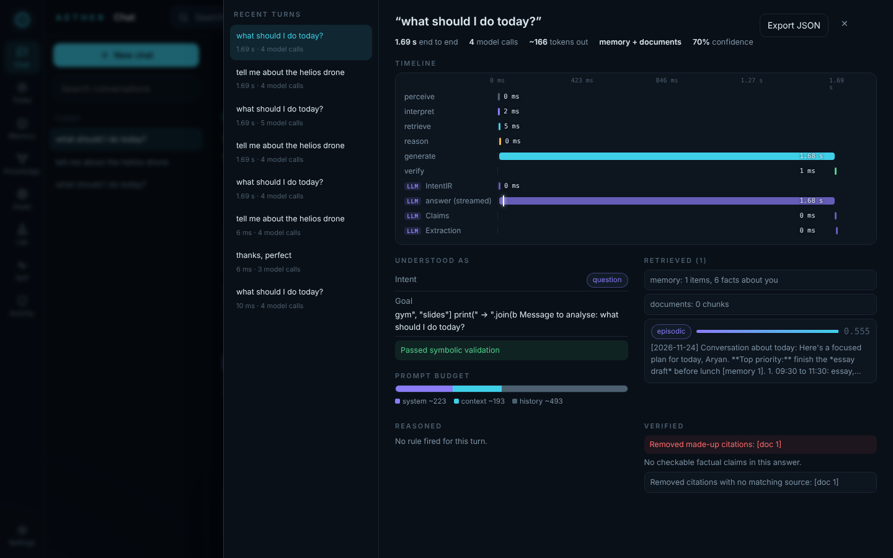

**What if…** Ask AETHER to reason about a hypothetical: `kabir parent_of zoe; riya lives_in mumbai; !user likes robotics`. It copies the knowledge graph into a sandbox, applies the assumptions (overriding one-valued facts like where someone lives), re-runs every rule, and diffs the result: new conclusions with their proofs, conclusions that would no longer hold, and constraints that would break or be resolved. The graph lights up the difference. Your real memory is never touched. It is also a tool, so you can just ask in chat ("what if Kabir had a daughter Zoe?").

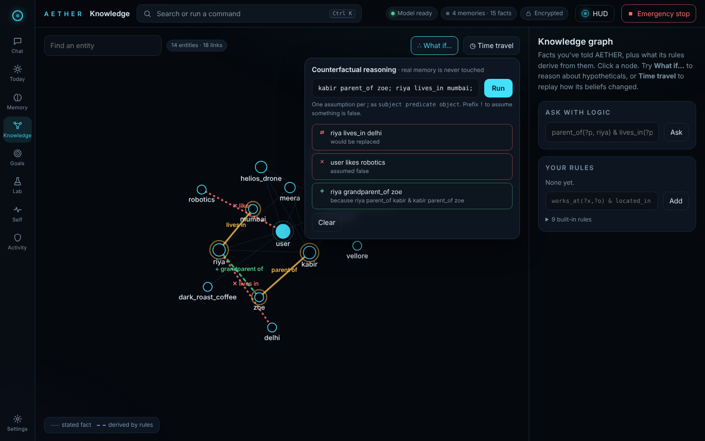

**Time travel.** Beliefs in AETHER have a lifetime: when it learned something and when a newer fact replaced it. Press play on the Knowledge page and watch the graph grow and change, one belief at a time, with the rules re-derived at every moment. Click any entity to see its belief history.

**Mission control.** A background goal is shown as a live dependency graph: the executive's plan, which specialist runs each task, what is done, what is running (edges into it animate) and what is waiting.

| Time travel | Mission control |
| --- | --- |
| 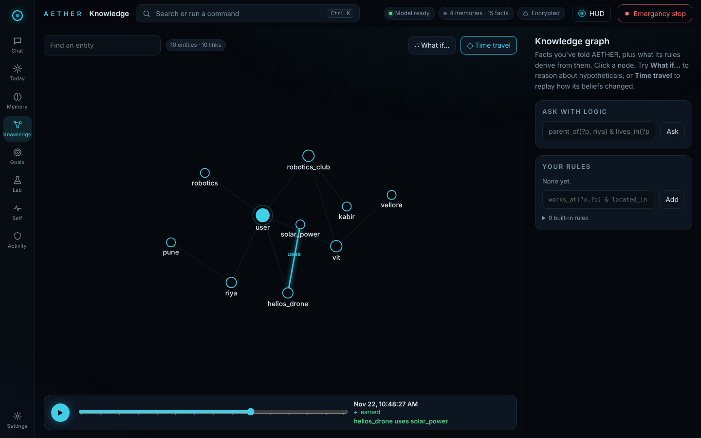 | 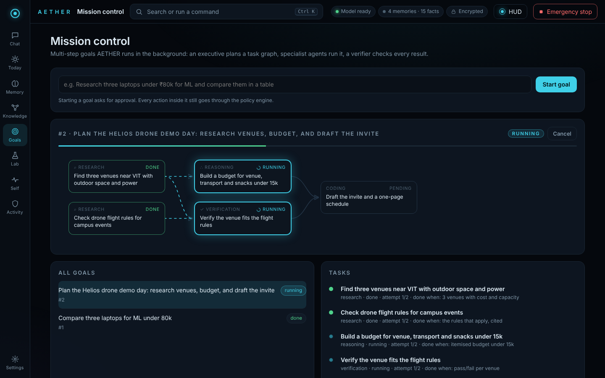 |

**HUD.** `Ctrl Shift H` (or the HUD button) turns the app into a full-screen voice interface. Hold `Space` to talk. The orb is drawn from real audio, your microphone's spectrum while you speak and AETHER's own synthesized voice while it answers, and the current pipeline stage shows underneath.

| Listening | Answering |
| --- | --- |
|  |  |

## New in Mark XXX

* **Memory map.** One glowing, force-directed graph of everything AETHER knows, centred on you: people, projects, places, memories, documents and goals, filed into the areas of your life (who you are, people, health, study, career, projects, goals, your preferences, how AETHER should work). It's real graph analysis, not decoration:
  * Louvain communities with a modularity score.
  * PageRank and betweenness, used to find the *god nodes* that hold your world together and the *bridges* between areas.
  * *Surprising connections* across communities.
  * *Suggested links* between things that share a lot of context (Adamic-Adar). Accept one and it becomes a fact.
  * A **Fix** tab: merge near-duplicate memories, retract weak inferred facts, find orphans and topics with no facts. Every change is logged.

  Search flies the camera to any node. Click a node to see its memories, facts, rule proofs and timeline. **Grow** replays how your map built up over time. Anything not connected to you (demo worlds, test data) is hidden, and `scripts\import_seed_pack.py <pack> --only-me` retires it. You can also ask in chat: "show my memory map".
* **Recursive self-improvement, two levels, approval-gated.**
  * Level 1: every night AETHER writes test questions from your own memories and tries changes to its retrieval settings. It keeps a change only if it wins on questions it never practised on, and then asks you.
  * Level 2 (RSI²) improves the improver:
    * Thompson sampling over its strategies (small step, random jump, mixing past winners, back to default).
    * The 1/5 success rule on each step size.
    * A budget that shrinks once it has converged.
    * A curriculum that weights the questions it still gets wrong.
  * The rails are fixed in code: tunable settings only, within hard bounds, never security, tools or code, and every change can be reverted. See it under Self, or say "improve yourself".
* **Vision.** A brighter look: violet-black with synthetic-life magenta, solar gold and crimson glow. Arc (Mark XXIX cyan) and Light are one click away in Settings.
* **User and Admin modes.** User mode shows only what you use day to day: Chat, Today, Grind 75, Memory, Map and Goals. Admin mode (`Ctrl Shift D`, or the chip next to the title) adds the thinking panel, turn traces, Knowledge, Lab, Self, Activity and raw model, security and tool settings.
* **Updates always show.** The page stamps its scripts with the code version, and static files are always revalidated, so a browser cache can't hide a new release.

## New in Mark XXIX

Rebuilt around one idea: an assistant feels real because of how fast and how present he is, not raw IQ.

* **He hears you as you speak.** While you talk, the quick Whisper model transcribes what you've said so far every ~0.6 s. It shows live at the bottom of the screen ("HEARING remind me to call mom and"), and it decides when you've finished. A finished request ("open spotify", anything ending in "?") ends after a short pause. A sentence that trails off on "and", "um" or "the" waits about 1.6 s, so he stops cutting you off (`[voice] partials`, `end_of_turn`).
* **He never sounds frozen.** If the answer hasn't started after 1.2 s, he says "One moment." straight away, then the answer follows (`ack_after_s`). Phrases he says all the time are synthesized once and cached. The next sentence is synthesized while the current one plays, so there are no gaps.
* **A real voice.** Kokoro, an 82M-parameter neural TTS, runs on the CPU with British voices (bm_george by default; also bm_lewis, bm_fable, bm_daniel and bf_emma). You can blend voices into your own: `kokoro_voice = "bm_george:0.7,bm_lewis:0.3"`. Alerts come out a touch quicker. Install it with `pip install kokoro-onnx`, then `scripts\get_model.py kokoro`. Piper and the Windows voice remain fallbacks.
* **Three brains.**
  * The reflex layer answers timers, apps, maths and similar requests in milliseconds without a model.
  * An optional fast talker (Qwen2.5-1.5B fully on the GPU, `get_model.py fast` + `[llm] fast_model_path`) answers spoken small talk and memory questions.
  * The 7B keeps documents, research, tools and planning, and "One moment." covers its thinking time.
* **One live nervous system.** An event bus (`/api/events`) carries what he hears, which stage he's on, and what he says to every process: the voice listener, the app, the HUD, Nova and your phone.
* **Talk from your phone.** Set `[relay] enabled = true` and Settings shows a link for your phone on the home Wi-Fi. Hold the button to talk, or type, and he answers in his own voice.
  * The link is protected by a pairing key and served over https, because phones only allow the mic on https; you accept the certificate warning once.
  * Anything asked from the phone that changes something still needs your OK at the PC.
* **More memory nets.**
  * *Working memory* goes into every prompt: what app you're in, how long you've been at it, this week's focus, what he just did, and a question he's waiting on you to answer.
  * A *learned reranker* notes which retrieved memories each answer actually used. Once it has enough examples and proves itself on held-out data, the memories that tend to help come first. It retrains overnight with the rest of sleep consolidation.
* **A model of you.** "How am I doing?" gives energy, focus, load and mood, estimated from your sleep, late nights, time of day, hours at the keyboard, calendar, what's due and 75 Hard. It also says what would help next ("Linear algebra in 25 min", "60 g of protein to go", "a five-minute break"). It's on Today ("You right now"), in his prompt and in the status report.
* **A new look.** Deep navy-black with arc-reactor cyan and amber for anything needing attention: thin HUD frames with corner brackets, a faint grid, scanlines and monospace telemetry.

**Honest limits on a 4 GB RTX 3050:**
* Kokoro has no voice cloning. You can blend its voices, but cloning a specific voice needs XTTS/F5-class models that don't fit next to the LLM.
* Kokoro runs on the CPU. It's quick on a Ryzen 5600H, and one-sentence lookahead hides the rest.
* Partial transcripts use the CPU Whisper models; streaming GPU ASR (Parakeet) would need VRAM the LLM is using.
* The fast talker plus the 7B means fewer 7B layers on the GPU. Start with the 7B at about 14 layers and run `scripts\tune_gpu.py`.

## New in Mark XXVIII

* **A boot sequence.** Opening the app runs a short systems check (neural core, symbolic engine, memory, search, uplink, voice) with each one coming online. Once per session; click or press any key to skip.
* **"Status report."** Also "systems check" or "run diagnostics". Every part of AETHER in one go (brain, memory and encryption, facts and rules, the learned router, what's waiting for your OK, which nudges he's holding back, privacy, battery and RAM), plus how you're doing today.
* **"What did we talk about yesterday?"** Recall by date: yesterday, last night, this morning, on Tuesday, last week, 3 days ago, on 24 November. Add a topic ("what did I say about the internship last week?") to search only that window. Code reads the dates and builds the answer from your chats and memories, so it's instant and never invents anything.
* **"How did my week go?"** Your week in numbers: hours at the keyboard and your longest day, 75 Hard days completed, workouts, weight change and whether it's heading toward your target, plan progress, and what next week is about. On Sunday evening he offers it himself (`[proactive] weekly_review`), and it's a learned nudge, so it fades if you never open it.

## New in 1.0 ("AETHER Final")

One name everywhere: he's **AETHER**, and the little orb on your desktop is **Nova**. Call either name.

* **He stops listening when you're done.** The name check no longer hears his name in every sentence (Whisper isn't primed with it any more, and a "probably not speech" score is checked). After a wake he listens for 8 seconds, not forever. He only keeps the mic open after a reply that ends in a question, and at most three times in a row (`[voice] follow_up = "question" | "always" | "off"`).
* **Grind 75, built in.** The 75 Hard tracker, food and calorie log, weight trend and coach now live inside AETHER (Grind 75 in the rail, `Ctrl+3`). Your existing app data is imported the first time. Voice works too: "I weigh 63.1", "I had 3 roti and dal", "drank 500 ml", "did my workout", "how's my 75 hard going?", "my target weight is 67". The coach is AETHER's own local model.
* **Your plans, by horizon.** `plans.md` in AETHER's data folder (or Today → Plan → Edit) holds what you're doing now, this week's focus, your daily list, and what's later. "What's my plan this week?", "I finished week 1", and the morning brief leads with it.
* **Plan my day.** "Plan my day" orders today's plan, what's due and the workout around your calendar: deep work in your sharpest hours (learned from when you actually focus), due things first, the gym at your usual time, short breaks, and done by wind-down (`[dayplan]`).
* **Rest is part of the plan.** After a long day past evening he suggests calling it, and after several hard days in a row he suggests a rest day. When you doubt yourself, he answers with what you've actually done, not pep talk.
* **Keeps you up to date.** "While you were away" in the morning brief clusters the news on topics you care about (`[online] interests`), and "keep an eye on <topic>" watches something and tells you when it moves.
* **Nudges that learn.** Every optional nudge (breaks, rest, check-ins, news...) learns, per time of day, whether you act on it or dismiss it, and shows you less of what you keep waving away (Thompson sampling). Reminders, alarms and calendar alerts are never held back.
* **A stronger neuro-symbolic engine.** Facts and rules carry confidence through chains (product along a chain, noisy-or across proofs). He mines candidate rules from your facts and habits from your days, and only keeps the ones you approve (Self → Rules and habits I noticed). A small router distilled from the main model reads simple messages itself, saving a model call each time. Answers built on your documents are checked sentence by sentence against the passages, and anything not found (including wrong numbers) is flagged.
* **Memory at disk scale.** Search is now a real BM25 index over encrypted term hashes plus an in-memory vector index, so a whole drive of documents indexes in minutes and searches in milliseconds.
* **A new look.** Deeper colours, a slow aurora behind everything, glass cards.

## Closer to a real assistant

* **It talks while it thinks.** Voice replies start at the first finished sentence instead of after the whole answer, both in the always-listening voice loop and in the HUD. If the fact checker changes what was said, it stops and says the corrected version. Spoken replies are asked to be short and plain.
* **Routines.** Name a set of steps once ("focus mode": open Spotify, set a stretch reminder) and saying the name runs them instantly, without the model. Every step still goes through the policy engine, asks when it should, and is audited. Make them on the Today page.
* **Look at my screen.** "What does this error mean?" takes a screenshot, asks the local vision model, and deletes the image. Off until you enable screen access, and it asks every time.
* **Persona.** `persona = "aether"` (the default) is understated and anticipates the next step; set `address_as = "sir"` if you want the full effect.
* **Understands Indian English, and learns your voice.** Whisper is told to expect Indian English plus your name and the names and places from your memories. `scripts/learn_my_voice.py` (20 phrases, 5 minutes) builds a personal correction dictionary and checks that he hears his name in your voice, and every fix you type in the HUD teaches it more. Wake him with "AETHER" or "Nova" (with or without "hey"); "Nova" is the easier one if your accent trips up "AETHER".
* **Nova, a desktop companion.** A small always-on-top orb with eyes in the corner of the screen: blue when idle, amber when listening or thinking, shifting between the two while AETHER speaks. Click to talk, double-click to type a command right there ("open youtube", "what's on my to-do list") and read the answer in a speech bubble, drag to move, right-click for a menu. Plain Tk, almost no CPU.
* **Everyday skills, instant.** Timers and alarms that ring even with the app closed ("set a pasta timer for 12 minutes", "wake me up at 6:30"), volume, mute, play/pause/next, brightness, "play lofi on YouTube" (it finds the video and plays it), "open GitHub", "google best laptop under 80k", maths and unit conversions ("15% of 2400", "5 km in miles"), notes ("take a note: ..."), the clipboard ("summarise what I copied", "copy that"), battery and system status, and lock / sleep / restart / shut down. When you ask for one of these, or to open an app, it just happens (`[security] run_when_asked`). It still asks if the request came from a document, a web page, a background goal or a suspected prompt injection, and shutdowns wait 30 seconds so "cancel shutdown" can stop them. Common phrasings run in milliseconds without the model, and each one is still a policy-checked tool.
* **A to-do list that repeats.** "Add buy milk to my to-do list", "remind me to stretch every day at 6pm", "every morning remind me to check email", then "make it a daily thing" or "make that weekly" turns the last item into a repeating one. A repeating item comes back on its next day when you tick it off ("mark stretching as done", "I finished stretching"), a missed one moves to today instead of piling up as overdue, and one with a time rings like an alarm. "What's on my to-do list?" reads it out. The Today page shows the same list.
* **Any app, by name.** "Open Spotify / WhatsApp / Discord / VS Code" finds the app wherever it came from (Start menu, Microsoft Store, PATH), and opens the website only when the app isn't installed. Folders ("open my downloads"), Windows settings pages ("open bluetooth settings"), "close Chrome", "take a screenshot", "show desktop", "open the HUD" and "open AETHER settings" work too. Opening and closing still only run without an Allow box when you said it yourself (`run_when_asked`); `security.open_any_app = false` limits opening to `[security.apps]`.
* **Updates just work.** After a `git pull`, double-clicking `start.bat` replaces whatever is still running from before (tray, server, voice listener, Nova), so you never end up talking to yesterday's code. No need to quit from the tray first.
* **It always answers out loud.** Without a Piper voice the always-on listener speaks with the built-in Windows voice, and the HUD uses the browser's own voice, instead of going quiet. Timers and timed reminders are said aloud too, not just shown. It no longer cuts itself off when its own voice comes back through the laptop speakers.
* **Fast on small things.** A short general question skips the model's interpretation pass, the fact-check only runs when the answer is about you or about someone or something AETHER has facts on, and learning from the turn happens after the reply. `fast_mode = false` brings back the full path for every turn.
* **"AETHER, good morning."** You get a spoken briefing: the weather where you are, your first event and when you're done, what's due or overdue, email from people who matter, what AETHER is still working on, and three headlines. Code puts it together from what AETHER already knows, so it's instant, works without the model, and never makes anything up. The first greeting of the morning triggers it too. It's also on the Today page ("Hear it"), on the HUD's ☀ button, in the tray menu, and in the morning notification.
* **It goes online for live information.** The `weather` (Open-Meteo) and `news` (RSS feeds you choose, or Google News for a topic) tools need no accounts or API keys, and web search and page reading were already there. Only the place name or search topic leaves your PC, never your memories or files. Everything fetched counts as untrusted, and `security.network = false` makes AETHER fully offline again. Set `online.location` for weather.
* **Your calendar, read locally.** Export your calendar as `.ics` (Outlook, Google Calendar, Apple Calendar or a university timetable) into `Documents\AETHER\calendar`, or turn on `calendar.outlook` to read the classic Outlook app directly. Nothing syncs online. Recurring events, time zones, cancellations and moved occurrences are handled. Ask "what's on friday?" or "put pair study on thursday 4pm", and the Today page shows the day as a strip with your free time and a now line. Today's schedule is in every prompt, so "can I fit the gym in?" just works.
* **Your email, read locally, never sent.** Point `[mail]` at a folder of `.eml` files or an `.mbox` archive (Outlook drag-and-drop, Thunderbird, Google Takeout), or turn on `mail.outlook` to read the Outlook app's inbox. "Anything from Prof. Rao?" searches it, people on your `vip` list get a notification, and "draft a reply to Riya" writes an unsent `.eml` that Outlook opens ready to edit. You press Send; AETHER has no way to send mail. Email is written by strangers, so everything read from it is untrusted: after reading a suspicious message, every action in that turn asks first.
* **It speaks first when it matters.** "Linear algebra in 15 minutes, Room 4", an evening review of what's still open plus tomorrow's first event, and a low-battery warning when you're unplugged. Same quiet hours and hourly limit as before, and an event alert nobody saw in time is dropped instead of shown late.
* **It notices.** After 90 minutes at the keyboard without a five-minute break it suggests one ("1 h 34 min, mostly in VS Code"). It only reads how long ago you last typed and the name of the app in front, never window titles or the screen. It also spots deadlines before they arrive, in calendar events ("Essay submission"), reminders and dates written in your indexed documents ("lab report due 4 December"), and nudges you 7, 3 and 1 days ahead. Today shows both, and each has a switch in Settings.
* **Always one keystroke away.** `aether-tray` sits in the system tray, starts the server, and `Ctrl+Alt+J` from any app opens the voice HUD. Notifications arrive as Windows notifications, and the menu has pause, emergency stop and "start with Windows" (current user only, no admin).
* **Speed knobs.** `scripts\bench.py` now measures time to the first word, and `--compare-draft` tells you whether prompt-lookup speculative decoding speeds up your machine.
* **It learns from being corrected.** Say "no, she moved to Delhi in October" and the question, the wrong answer and your fix are kept as a lesson. The next similar question gets it in the prompt, so the mistake isn't repeated. When the PC has been idle for 30 minutes and is plugged in, AETHER uses the model to turn each correction into a one-line rule and a better answer. It also merges duplicate memories, lets old guesses fade and writes `learning\sft.jsonl` and `dpo.jsonl` for fine-tuning. Self shows **What I learned this week** (new facts, what changed, lessons, preferences), and you can forget any lesson. A 7B LoRA needs about 6 GB of VRAM, so on a 4 GB card the learning comes from these lessons rather than new weights. `scripts\train_adapter.py` checks your machine, and `[llm].adapter_path` loads an adapter trained elsewhere.

| Routines | A routine run from chat |
| --- | --- |
|  | 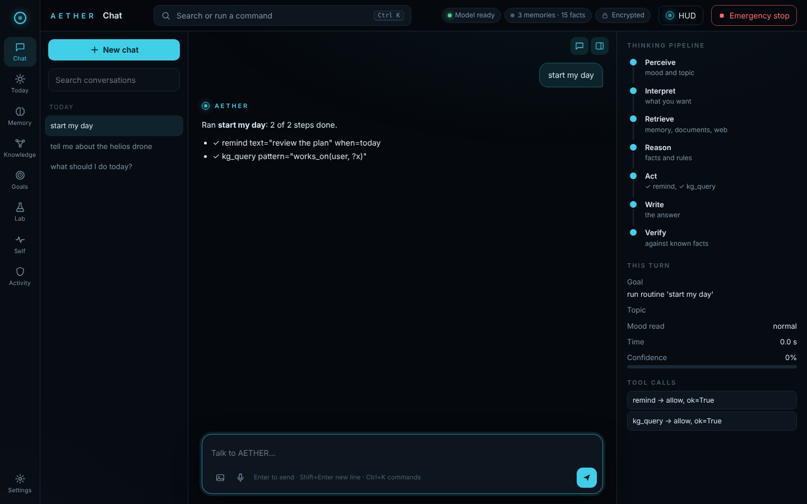 |

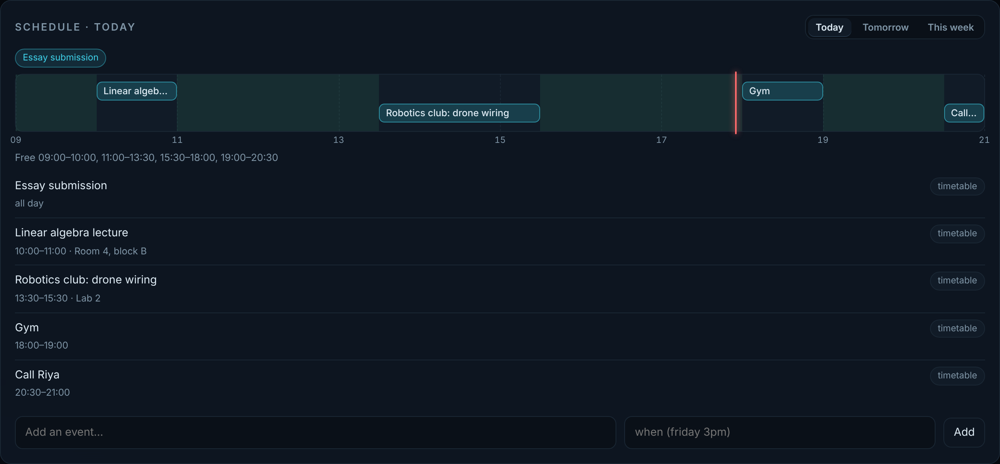

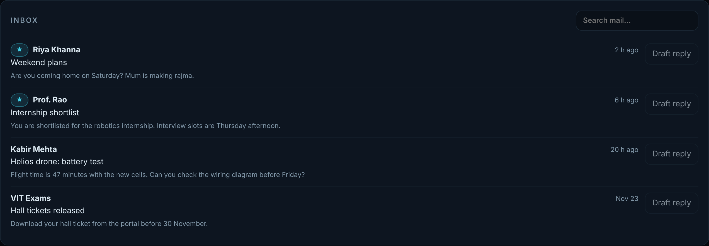

| The morning briefing, spoken in the HUD | And on the Today page |
| --- | --- |
| 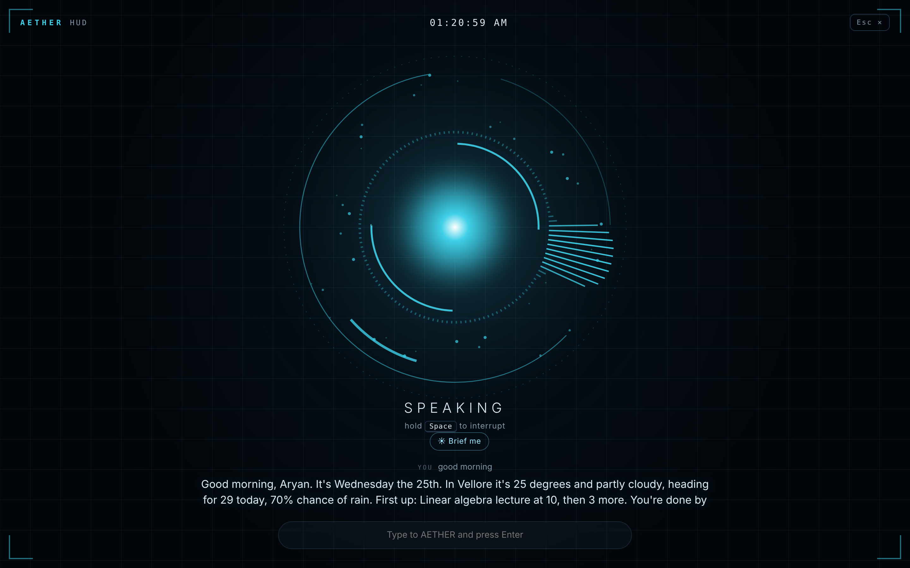 | 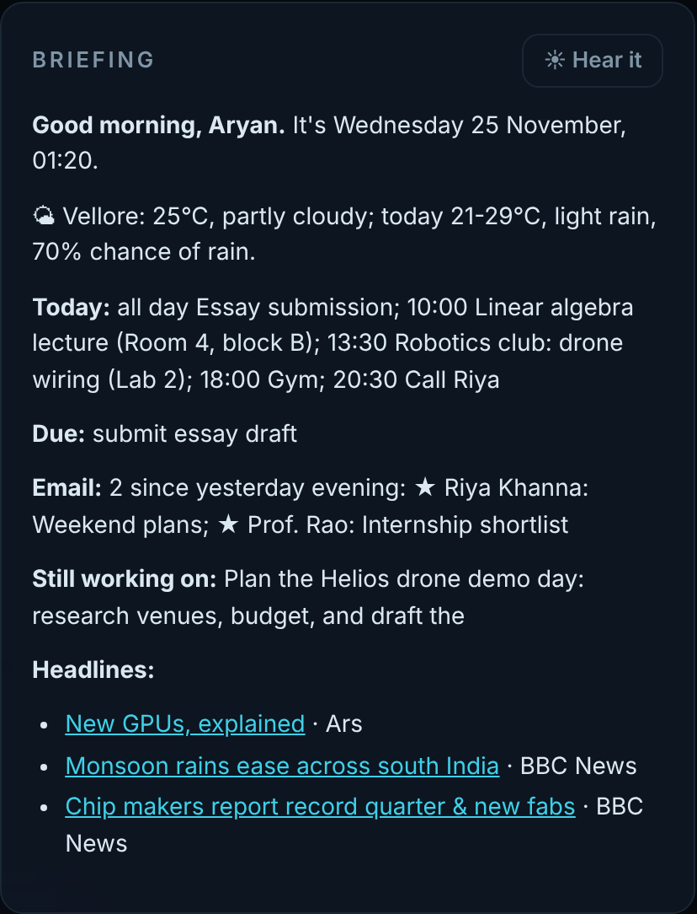 |

## The app

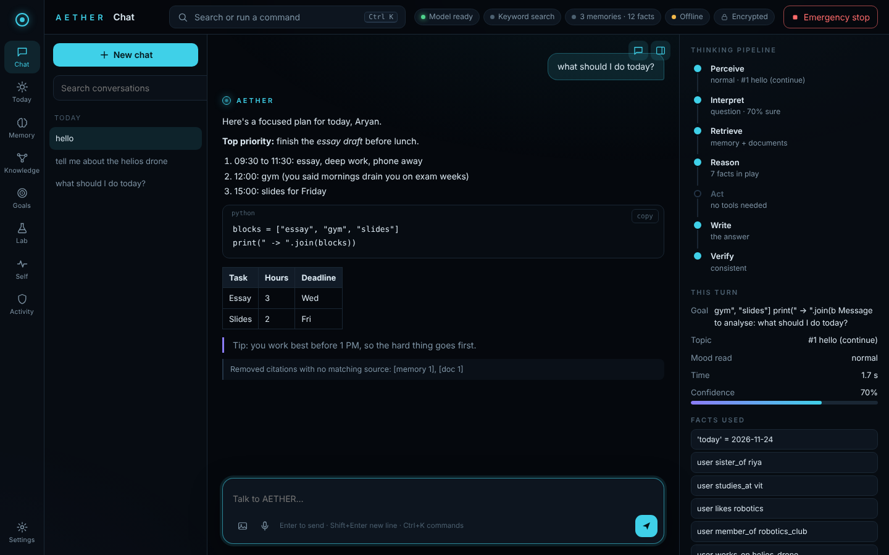

`aether-server` opens a local web app at `http://127.0.0.1:8765` (it never listens beyond your PC and loads nothing from the internet):

* **Chat:** replies stream word by word while the side panel shows each stage live (perceive, interpret, retrieve, reason, act, write, verify), with the facts, tools and corrections behind the answer. Markdown, code with copy buttons, colour-coded citations, 👍/👎, read-aloud, saved conversations with search and pinning, image drop-in and push-to-talk.
* **Today:** your schedule with free time, your inbox, a brief, reminders, goals, routines and anything waiting for your approval.
* **Memory:** search and forget memories, toggle preferences and see when they changed, confirm or reject patterns AETHER noticed.
* **Knowledge:** an interactive map of everything AETHER knows, with rule-derived links, proofs ("why?"), logic queries and your own rules.
* **Mission control, Lab, Self, Activity, Settings:** background agents with a live task graph, the optimization workspace, performance and self-improvement, the full audit log with undo, and safe settings with sliders.
* `Ctrl K` opens a command palette that also searches memories, facts and past chats. Dark and light themes.

| Knowledge map | Light theme |
| --- | --- |
|  | 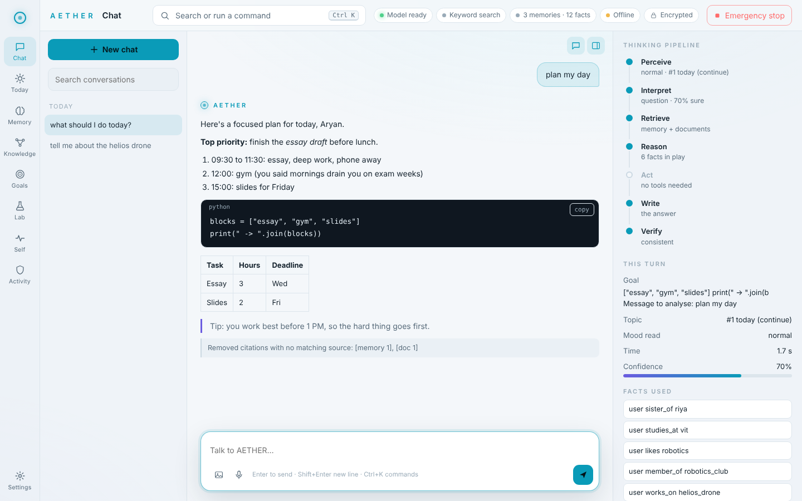 |

## Setup on Windows 11 (HP Victus 15 defaults)

First time? Follow **[docs/GETTING_STARTED.md](docs/GETTING_STARTED.md)**: it goes from a fresh laptop to talking to AETHER, with a troubleshooting table. The short version, for people who've done this before:

Requirements: Python 3.11 (from python.org, with the `py` launcher), and for the GPU an NVIDIA driver 550 or newer. The defaults in `aether.example.toml` are tuned for an RTX 3050 Laptop (4 GB), Ryzen 5 5600H and 16 GB RAM.

```powershell
git clone https://github.com/aryankhanna1409/A.E.T.H.E.R C:\AETHER
cd C:\AETHER
powershell -ExecutionPolicy Bypass -File scripts\setup_windows.ps1 -Cuda   # drop -Cuda for CPU only
.\.venv\Scripts\python scripts\get_model.py                                # 7B model, ~4.7 GB, one time
.\.venv\Scripts\python scripts\get_model.py voice                          # optional: speaking voice
notepad aether.toml                                                        # model_path, your folders, voice path
.\.venv\Scripts\python scripts\tune_gpu.py                                 # optional: best gpu_layers for your GPU
.\.venv\Scripts\aether-server                                              # opens the UI at http://127.0.0.1:8765
```

Other ways in:

* `.\.venv\Scripts\aether` for the terminal (type `/help`).
* Always listening once started: say "AETHER" or "Nova". Mute it from the tray. (`.\.venv\Scripts\aether-voice` runs it without the tray.)
* `.\.venv\Scripts\aether-tray` for the tray icon and the `Ctrl+Alt+J` voice hotkey (`pip install -e ".[tray]"` first).
* `desktop\` holds a Tauri 2 shell that wraps the UI as a native window (see `desktop\README.md`).
* `scripts\build_installer.ps1` builds a one-click `AETHER-Setup.exe` with Inno Setup.

### Choosing a model

| Your PC | Model | Command |
| --- | --- | --- |
| 4 GB VRAM (RTX 3050 Laptop), 16 GB RAM | Qwen2.5-7B Q4_K_M, 20 of 28 layers on the GPU (default) | `get_model.py` |
| Want faster replies on 4 GB | Qwen2.5-3B Q4_K_M, fully on the GPU (about 3x quicker) | `get_model.py small` |
| 12 GB+ VRAM | Qwen2.5-14B Q4_K_M | `get_model.py large` |

Newer 4B models (Qwen3 class) need a newer llama.cpp than the pinned `llama-cpp-python` 0.3.4 CUDA wheel, so they are not the default yet.

Structured outputs are enforced with a JSON grammar, so even small models return valid intermediate representations.

## Check it on your PC

```powershell
.\.venv\Scripts\pytest                       # 291 unit tests, no model needed, about 25 s
.\.venv\Scripts\aether-eval                  # 10 end-to-end scenarios with YOUR model, 5-15 min
.\.venv\Scripts\python -m aether.evals.symbolic   # does the symbolic layer help? plain 7B vs RAG vs AETHER, 30-45 min
.\.venv\Scripts\python scripts\bench.py      # speed against the performance budget
```

`aether-eval` checks routing, fact learning and contradictions, preference enforcement, crisis resources, stress detection, document answers, prompt-injection resistance, topic switching, approval for deletes and the optimizer, all judged by code. It writes `eval_report.json`.

`python -m aether.evals.symbolic` asks your model the same 66 questions three ways: alone, with the usual retrieved notes (RAG), and through the full AETHER pipeline. The questions are about a small synthetic world (three families, their homes, jobs, studies, projects and allergies, some of which changed), so the run is the same every time and nothing personal is involved. It measures recall, multi-hop answers that need rules, updated facts, questions it cannot know, false premises and consistency across paraphrases, all scored by code, plus a hallucination rate. Open `bench_symbolic\report.html` for the charts and every answer. Add `--limit 3` for a five-minute look.

## Safety model

* AETHER starts **read-only** inside the folders you list. Writing needs a separate write root **and** your approval each time.
* Secrets (`.env`, keys, `.ssh`, browser profiles, credential stores) are blocked by code, whatever the model asks.
* Anything read from files, the web or the screen is untrusted data. If it contains instructions aimed at AETHER, the turn is tainted and every action needs your OK, with the reason shown.
* Memories and chats are encrypted at rest; the key only opens under your Windows account.
* `emergency stop` (or the red button) blocks every action until you say `resume`.
* Every access and change is in `audit.jsonl` and the Activity tab; file changes can be undone.
* The wellness companion is supportive conversation, not therapy. Crisis messages always get helpline information (Tele MANAS 14416 in India, 988 in the US, Samaritans 116 123 in the UK).

More in [docs/ARCHITECTURE.md](docs/ARCHITECTURE.md), [docs/SECURITY.md](docs/SECURITY.md) and the technical report ([PDF](docs/report/aether.pdf), [LaTeX source](docs/report/aether.tex)).
