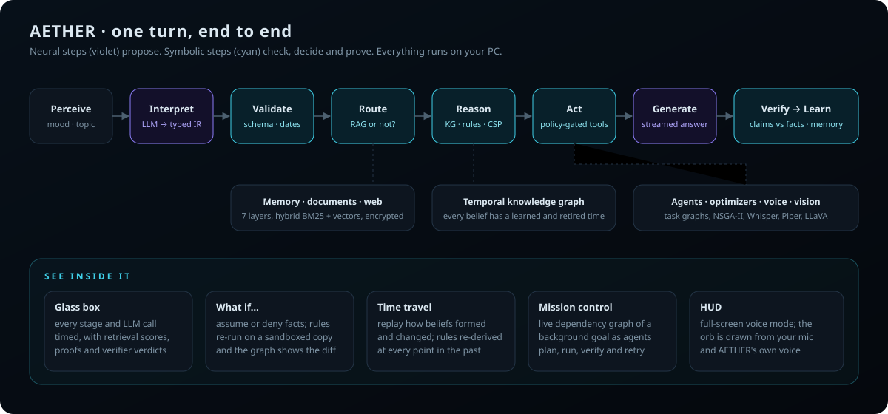
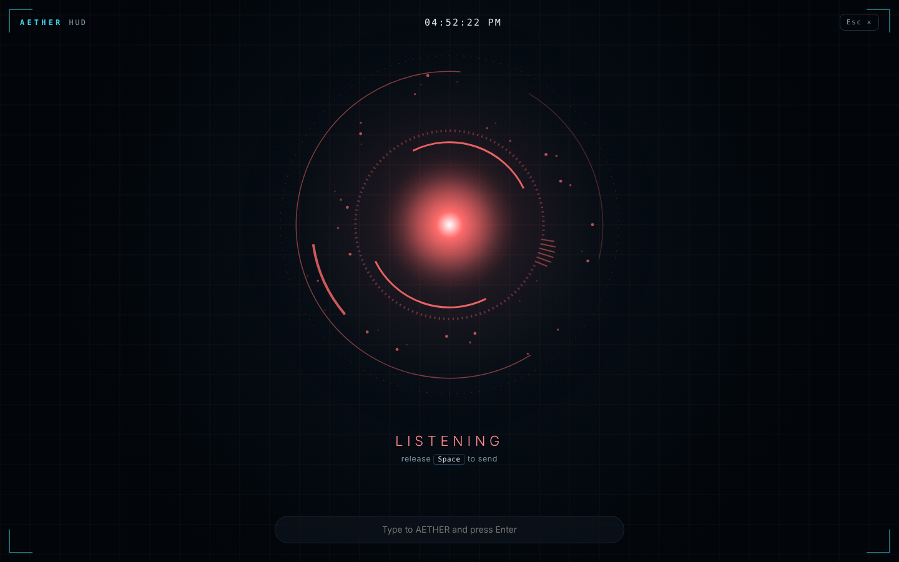
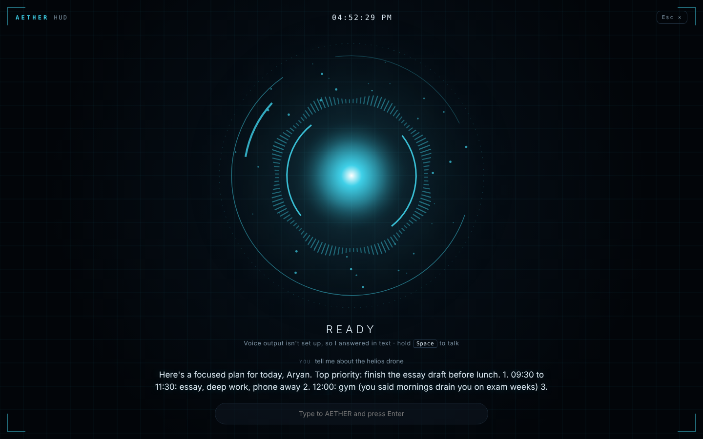
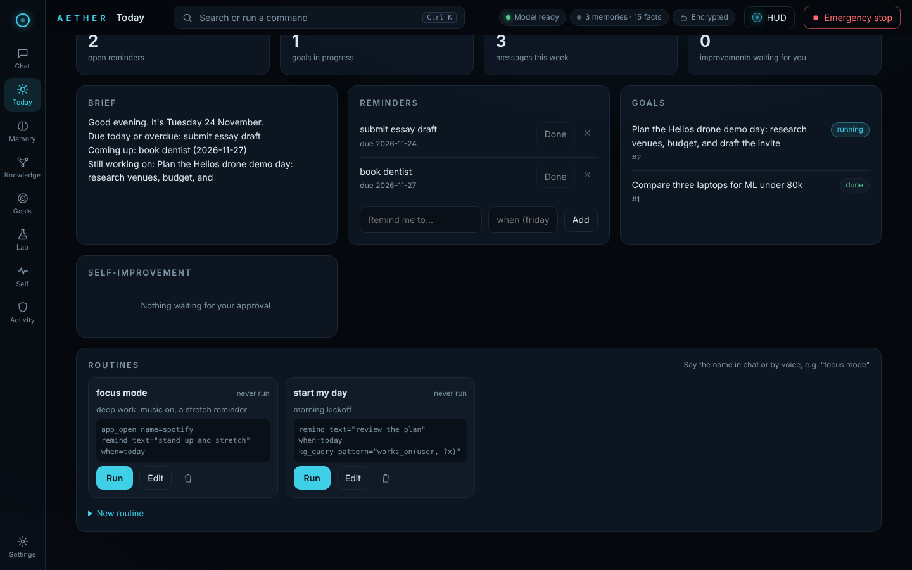
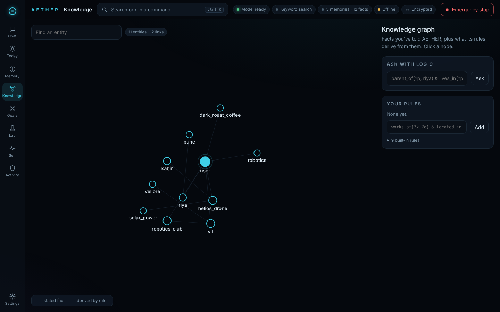

# AETHER

**Adaptive Engine for Thought, Heuristics, Evolution & Reasoning**: a fully local, neuro-symbolic personal assistant for Windows 11.

**New here? [Download and run it on your laptop, step by step →](docs/GETTING_STARTED.md)**

No cloud APIs. No Ollama. The language model runs **in-process** through `llama-cpp-python` (GGUF weights on your disk). Embeddings, speech, vision and memory are local too, and your memories live in one encrypted SQLite file on your machine. The only network use is optional web research, which you can switch off.

## What it does

| Area | Capability |
| --- | --- |
| Conversation | Local Qwen2.5 model, desktop UI, terminal chat, and voice ("hey jarvis") with barge-in |
| Neuro-symbolic core | The model turns each message into a typed intermediate representation; code validates it, resolves dates, checks it against a knowledge graph and rule engine, solves constraints exactly, and verifies the answer against known facts (`/why` shows proofs) |
| Memory | Episodic, semantic, procedural, preference, prospective, observation and document layers; extraction after chats, summaries, reminders, decay, correction and deletion; hybrid BM25 + vector search |
| RAG vs non-RAG | A router decides per message: direct, memory, documents, web, symbolic, tools or optimize. Small talk does no retrieval |
| Documents and research | Folder watcher keeps your notes indexed, optional reranker, cited research briefs that separate what you already knew from what is new, fake citations removed by code |
| Agents | Multi-step goals as a persistent task graph: executive, research, reasoning, coding, operator, memory and verification agents; bounded retries; one re-plan; runs in the background |
| Computer control | Open allowlisted apps, sandboxed shell, move and delete to a trash with undo, screen reading (OCR) and UI automation, all off or asking first by default |
| Personalization | Learns what you like and hate in replies ("stop the long intros" takes effect at once); notices patterns about you but only keeps them if you confirm; timeline of every change |
| Wellness companion | Detects stress, chooses listening, planning, relaxation and other modes, asks "listen or solve?", and a crisis path whose helplines are guaranteed by code |
| Metaheuristics | Genetic algorithm, simulated annealing, particle swarm, tabu search, differential evolution and NSGA-II (Pareto trade-offs); self-tunes its own retrieval on your eval cases |
| Metacognition | Measures every turn, learns from 👍/👎 and "that's wrong", reviews its own finished goals, and proposes improvements that only apply when you approve |
| Proactive | Due reminders, a morning brief, finished goals and gentle check-ins, with quiet hours and a rate limit |
| Security | Policy engine on every action, secrets denylist, prompt-injection tripwire with taint mode, encryption at rest (DPAPI-protected key), audit log, emergency stop |



## See inside it

Most assistants are a black box. AETHER records everything it does and lets you poke at its mind.

**Glass box.** Every answer has an *Inspect* button. It opens the full trace of that turn: a waterfall of every stage and every model call (with time to first token), what the router retrieved and how each item scored, which facts the rules derived and the exact facts that prove them, which claims the verifier confirmed or caught, and how the prompt budget was spent. Export any trace as JSON. Traces are encrypted at rest like the rest of your history.


**What if…** Ask AETHER to reason about a hypothetical: `kabir parent_of zoe; riya lives_in mumbai; !user likes robotics`. It copies the knowledge graph into a sandbox, applies the assumptions (overriding one-valued facts like where someone lives), re-runs every rule, and diffs the result: new conclusions with their proofs, conclusions that would no longer hold, and constraints that would break or be resolved. The graph lights up the difference. Your real memory is never touched. It is also a tool, so you can just ask in chat ("what if Kabir had a daughter Zoe?").


**Time travel.** Beliefs in AETHER have a lifetime: when it learned something and when a newer fact replaced it. Press play on the Knowledge page and watch the graph grow and change, one belief at a time, with the rules re-derived at every moment. Click any entity to see its belief history.

**Mission control.** A background goal is shown as a live dependency graph: the executive's plan, which specialist runs each task, what is done, what is running (edges into it animate) and what is waiting.

| Time travel | Mission control |
| --- | --- |
|  |  |

**HUD.** `Ctrl Shift H` (or the HUD button) turns the app into a full-screen voice interface. Hold `Space` to talk. The orb is drawn from real audio, your microphone's spectrum while you speak and AETHER's own synthesized voice while it answers, and the current pipeline stage shows underneath.

| Listening | Answering |
| --- | --- |
|  |  |

## Closer to Jarvis

* **It talks while it thinks.** Voice replies start at the first finished sentence instead of after the whole answer, both in the always-listening voice loop and in the HUD. If the fact checker changes what was said, it stops and says the corrected version. Spoken replies are asked to be short and plain.
* **Routines.** Name a set of steps once ("focus mode": open Spotify, set a stretch reminder) and saying the name runs them instantly, without the model. Every step still goes through the policy engine, asks when it should, and is audited. Make them on the Today page.
* **Look at my screen.** "What does this error mean?" takes a screenshot, asks the local vision model, and deletes the image. Off until you enable screen access, and it asks every time.
* **Persona.** `persona = "jarvis"` (the default) is understated and anticipates the next step; set `address_as = "sir"` if you want the full effect.
* **Everyday skills, instant.** Timers and alarms that ring even with the app closed ("set a pasta timer for 12 minutes", "wake me up at 6:30"), volume, mute, play/pause/next, brightness, "play lofi on YouTube" (it finds the video and plays it), "open GitHub", "google best laptop under 80k", maths and unit conversions ("15% of 2400", "5 km in miles"), notes ("take a note: ..."), the clipboard ("summarise what I copied", "copy that"), battery and system status, and lock / sleep / shut down (which always ask first). Common phrasings run in milliseconds without the model, and each one is still a policy-checked tool. They come from the features that home-built Jarvis projects on YouTube and GitHub keep implementing.
* **"Hey Jarvis, good morning."** You get a spoken briefing: the weather where you are, your first event and when you're done, what's due or overdue, email from people who matter, what AETHER is still working on, and three headlines. Code puts it together from what AETHER already knows, so it's instant, works without the model, and never makes anything up. The first greeting of the morning triggers it too. It's also on the Today page ("Hear it"), on the HUD's ☀ button, in the tray menu, and in the morning notification.
* **It goes online for live information.** The `weather` (Open-Meteo) and `news` (RSS feeds you choose, or Google News for a topic) tools need no accounts or API keys, and web search and page reading were already there. Only the place name or search topic leaves your PC, never your memories or files. Everything fetched counts as untrusted, and `security.network = false` makes AETHER fully offline again. Set `online.location` for weather.
* **Your calendar, read locally.** Export your calendar as `.ics` (Outlook, Google Calendar, Apple Calendar or a university timetable) into `Documents\AETHER\calendar`, or turn on `calendar.outlook` to read the classic Outlook app directly. Nothing syncs online. Recurring events, time zones, cancellations and moved occurrences are handled. Ask "what's on friday?" or "put pair study on thursday 4pm", and the Today page shows the day as a strip with your free time and a now line. Today's schedule is in every prompt, so "can I fit the gym in?" just works.
* **Your email, read locally, never sent.** Point `[mail]` at a folder of `.eml` files or an `.mbox` archive (Outlook drag-and-drop, Thunderbird, Google Takeout), or turn on `mail.outlook` to read the Outlook app's inbox. "Anything from Prof. Rao?" searches it, people on your `vip` list get a notification, and "draft a reply to Riya" writes an unsent `.eml` that Outlook opens ready to edit. You press Send; AETHER has no way to send mail. Email is written by strangers, so everything read from it is untrusted: after reading a suspicious message, every action in that turn asks first.
* **It speaks first when it matters.** "Linear algebra in 15 minutes, Room 4", an evening review of what's still open plus tomorrow's first event, and a low-battery warning when you're unplugged. Same quiet hours and hourly limit as before, and an event alert nobody saw in time is dropped instead of shown late.
* **Always one keystroke away.** `aether-tray` sits in the system tray, starts the server, and `Ctrl+Alt+J` from any app opens the voice HUD. Notifications arrive as Windows notifications, and the menu has pause, emergency stop and "start with Windows" (current user only, no admin).
* **Speed knobs.** `scripts\bench.py` now measures time to the first word, and `--compare-draft` tells you whether prompt-lookup speculative decoding speeds up your machine.

| Routines | A routine run from chat |
| --- | --- |
|  |  |


| The morning briefing, spoken in the HUD | And on the Today page |
| --- | --- |
|  |  |

## The app


`aether-server` opens a local web app at `http://127.0.0.1:8765` (it never listens beyond your PC and loads nothing from the internet):

* **Chat:** replies stream word by word while the side panel shows each stage live (perceive, interpret, retrieve, reason, act, write, verify), with the facts, tools and corrections behind the answer. Markdown, code with copy buttons, colour-coded citations, 👍/👎, read-aloud, saved conversations with search and pinning, image drop-in and push-to-talk.
* **Today:** your schedule with free time, your inbox, a brief, reminders, goals, routines and anything waiting for your approval.
* **Memory:** search and forget memories, toggle preferences and see when they changed, confirm or reject patterns AETHER noticed.
* **Knowledge:** an interactive map of everything AETHER knows, with rule-derived links, proofs ("why?"), logic queries and your own rules.
* **Mission control, Lab, Self, Activity, Settings:** background agents with a live task graph, the optimization workspace, performance and self-improvement, the full audit log with undo, and safe settings with sliders.
* `Ctrl K` opens a command palette that also searches memories, facts and past chats. Dark and light themes.

| Knowledge map | Light theme |
| --- | --- |
|  |  |

## Setup on Windows 11 (HP Victus 15 defaults)

First time? Follow **[docs/GETTING_STARTED.md](docs/GETTING_STARTED.md)**: it goes from a fresh laptop to talking to AETHER, with a troubleshooting table. The short version, for people who've done this before:

Requirements: Python 3.11 (from python.org, with the `py` launcher), and for the GPU an NVIDIA driver 550 or newer. The defaults in `aether.example.toml` are tuned for an RTX 3050 Laptop (4 GB), Ryzen 5 5600H and 16 GB RAM.

```powershell
git clone https://github.com/aryankhanna1409/A.E.T.H.E.R C:\AETHER
cd C:\AETHER
powershell -ExecutionPolicy Bypass -File scripts\setup_windows.ps1 -Cuda   # drop -Cuda for CPU only
.\.venv\Scripts\python scripts\get_model.py                                # 7B model, ~4.7 GB, one time
.\.venv\Scripts\python scripts\get_model.py voice                          # optional: speaking voice
notepad aether.toml                                                        # model_path, your folders, voice path
.\.venv\Scripts\python scripts\tune_gpu.py                                 # optional: best gpu_layers for your GPU
.\.venv\Scripts\aether-server                                              # opens the UI at http://127.0.0.1:8765
```

Other ways in:

* `.\.venv\Scripts\aether` for the terminal (type `/help`).
* `.\.venv\Scripts\aether-voice` for hands-free voice.
* `.\.venv\Scripts\aether-tray` for the tray icon and the `Ctrl+Alt+J` voice hotkey (`pip install -e ".[tray]"` first).
* `desktop\` holds a Tauri 2 shell that wraps the UI as a native window (see `desktop\README.md`).
* `scripts\build_installer.ps1` builds a one-click `AETHER-Setup.exe` with Inno Setup.

### Choosing a model

| Your PC | Model | Command |
| --- | --- | --- |
| 4 GB VRAM (RTX 3050 Laptop), 16 GB RAM | Qwen2.5-7B Q4_K_M, 20 of 28 layers on the GPU (default) | `get_model.py` |
| Want faster replies on 4 GB | Qwen2.5-3B Q4_K_M, fully on the GPU | `get_model.py small` |
| 12 GB+ VRAM | Qwen2.5-14B Q4_K_M | `get_model.py large` |

Structured outputs are enforced with a JSON grammar, so even small models return valid intermediate representations.

## Check it on your PC

```powershell
.\.venv\Scripts\pytest                       # 247 unit tests, no model needed, about 15 s
.\.venv\Scripts\aether-eval                  # 10 end-to-end scenarios with YOUR model, 5-15 min
.\.venv\Scripts\python scripts\bench.py      # speed against the performance budget
```

`aether-eval` checks routing, fact learning and contradictions, preference enforcement, crisis resources, stress detection, document answers, prompt-injection resistance, topic switching, approval for deletes and the optimizer, all judged by code. It writes `eval_report.json`.

## Safety model

* AETHER starts **read-only** inside the folders you list. Writing needs a separate write root **and** your approval each time.
* Secrets (`.env`, keys, `.ssh`, browser profiles, credential stores) are blocked by code, whatever the model asks.
* Anything read from files, the web or the screen is untrusted data. If it contains instructions aimed at AETHER, the turn is tainted and every action needs your OK, with the reason shown.
* Memories and chats are encrypted at rest; the key only opens under your Windows account.
* `emergency stop` (or the red button) blocks every action until you say `resume`.
* Every access and change is in `audit.jsonl` and the Activity tab; file changes can be undone.
* The wellness companion is supportive conversation, not therapy. Crisis messages always get helpline information (Tele MANAS 14416 in India, 988 in the US, Samaritans 116 123 in the UK).

More in [docs/ARCHITECTURE.md](docs/ARCHITECTURE.md), [docs/SECURITY.md](docs/SECURITY.md) and the technical report ([PDF](docs/report/aether.pdf), [LaTeX source](docs/report/aether.tex)).
