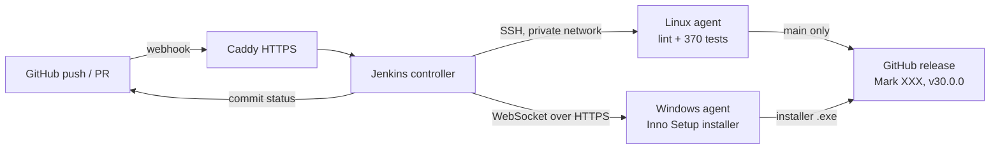

# CI/CD with Jenkins

Every push and pull request to AETHER is linted and tested by Jenkins, and every new Mark on `main` becomes a GitHub release with the Windows installer attached. Jenkins runs on one small AWS EC2 instance that is created by Terraform and configured entirely as code, so it can be rebuilt from this repository in about ten minutes.



## The pipeline

Defined in [`Jenkinsfile`](../Jenkinsfile).

| Stage | Runs on | When | What it does |
|---|---|---|---|
| Lint and test | `linux` agent | every branch and PR | Fresh venv, `ruff check .` (settings in [`ruff.toml`](../ruff.toml)), then the full pytest suite with JUnit and coverage reports. No model, GPU or personal data is needed. |
| Windows installer | `windows` agent | `main`, or any branch with **Build with Parameters > BUILD_INSTALLER** | Runs `scripts\build_installer.ps1`, which builds `dist\AETHER-Setup-<version>.exe` with Inno Setup and the version from `pyproject.toml`. The installer is archived on the build. |
| Release Mark | `linux` agent | `main` | [`ci/release.py`](../ci/release.py) makes sure the GitHub release for the current Mark exists, tagged `v<version>`, and attaches the installer. If that Mark is already released, it does nothing. |

Each build shows its Mark (for example "Mark XXX (v30.0.0)"), and Jenkins reports pass or fail back to the commit and pull request on GitHub.

**Releasing a Mark.** The major version in `pyproject.toml` is the Mark number (`30.0.0` is Mark XXX). Bump it in the Mark's pull request; when that merges and `main` goes green, Jenkins creates the release. Builds of `main` that do not change the version never create a release.

**Why two agents.** The tests are pure Python and run anywhere, so they run on a cheap Linux container next to Jenkins. The installer needs Inno Setup, which only runs on Windows, so packaging goes to a Windows machine (your own PC is fine). Until a Windows agent is connected the stage is skipped and releases are published without the installer, so builds never wait on a machine that is switched off.

## What runs where

```
infra/jenkins/
  terraform/            EC2 instance, Elastic IP, security group, IAM role, SSM parameters, optional budget alert
  docker-compose.yml    Caddy (HTTPS) + Jenkins controller + Linux agent
  controller/           Jenkins image: pinned LTS, plugins, and casc.yaml (Configuration as Code)
  agent/                Linux agent image with Python 3
  bootstrap.sh          Pulls secrets from SSM, writes .env, generates the agent SSH key, starts the stack
```

Security choices:

* No SSH port is open. Shell access goes through AWS Systems Manager Session Manager, so there are no keys to lose.
* Only ports 80 and 443 are open. Caddy gets a Let's Encrypt certificate automatically; with no domain of your own, the free `<ip>.sslip.io` name is used.
* Secrets (the GitHub token, admin password, webhook secret) live in SSM Parameter Store as SecureStrings and are read by the instance role. They are never in user data or the repository.
* The controller runs no builds. Anonymous visitors can see only the build badge.
* Webhook deliveries are verified with a shared secret.
* Pull requests from forks are not built, so no stranger's code runs on your agents.

## Set it up

You need about 30 minutes. Steps 1 to 3 are one-time.

### 1. AWS account and CLI

1. Create an account at <https://aws.amazon.com/>. Turn on MFA for the root user (top right menu > Security credentials).
2. In the IAM console create a user named `terraform`, attach the `AdministratorAccess` policy, then under **Security credentials** create an access key for **Command Line Interface**. Save both values.
3. On your PC:
   ```powershell
   winget install Amazon.AWSCLI Hashicorp.Terraform
   aws configure        # paste the access key and secret; region ap-south-1; output json
   aws sts get-caller-identity   # should print your account id
   ```

### 2. GitHub token

GitHub > Settings > Developer settings > **Fine-grained tokens** > Generate new token:

* Repository access: **Only select repositories** > `A.E.T.H.E.R`
* Repository permissions: **Contents: Read and write** (checkout, tags, releases), **Commit statuses: Read and write**, **Pull requests: Read-only**. Metadata is added automatically.
* Expiration: up to a year. To rotate it later, see "Change a secret" below.

### 3. Create the server

```powershell
cd infra\jenkins\terraform
copy terraform.tfvars.example terraform.tfvars
notepad terraform.tfvars          # paste the token; optionally set budget_email for a spend alert
terraform init
terraform apply                   # review the plan, type yes
```

`terraform.tfvars` and the Terraform state are git-ignored; keep them on your PC only. After about five minutes:

```powershell
terraform output jenkins_url
terraform output -raw jenkins_admin_password
```

Open the URL and sign in as `admin`. The **AETHER** job is already there and scans the repository.

### 4. GitHub webhook

Repository > Settings > Webhooks > **Add webhook**:

* Payload URL: `terraform output github_webhook_url`
* Content type: `application/json`
* Secret: `terraform output -raw github_webhook_secret`
* Events: **Let me select individual events** > **Pushes** and **Pull requests**

The first delivery should show a green tick. From now on a push starts a build within seconds.

### 5. Build badge

```powershell
terraform output -raw readme_badge
```

Paste the result under the title of `README.md`.

### 6. Windows agent (for the installer)

On the Windows PC that should build installers:

1. Install the tools once:
   ```powershell
   winget install EclipseAdoptium.Temurin.21.JRE JRSoftware.InnoSetup Git.Git
   ```
2. In Jenkins open **Manage Jenkins > Nodes > windows-1**. It shows the exact command with the agent secret. Run it in PowerShell from a folder such as `C:\jenkins`:
   ```powershell
   curl.exe -sO https://<jenkins-host>/jnlpJars/agent.jar
   java -jar agent.jar -url https://<jenkins-host>/ -secret <secret> -name windows-1 -webSocket -workDir C:\jenkins
   ```
   To have it start with Windows, put that command in a Task Scheduler task that runs at logon.
3. Tell the pipeline the agent exists (in a Session Manager shell on the server, see below):
   ```bash
   sudo sed -i 's/^WINDOWS_AGENT_ENABLED=.*/WINDOWS_AGENT_ENABLED=true/' /opt/aether/infra/jenkins/.env
   sudo AETHER_SSM_PREFIX=/aether-jenkins /opt/aether/infra/jenkins/bootstrap.sh
   ```

The agent only builds this repository's own branches, but it does run their code with your Windows account, so keep forks disabled (the default).

## Day-to-day

**Shell on the server.** AWS console > EC2 > Instances > `aether-jenkins` > **Connect** > **Session Manager**, or `terraform output -raw shell_command` with the Session Manager plugin for the AWS CLI installed.

**Change a secret** (for example a new GitHub token): edit `terraform.tfvars`, run `terraform apply`, then in a server shell `sudo AETHER_SSM_PREFIX=/aether-jenkins /opt/aether/infra/jenkins/bootstrap.sh`.

**Change Jenkins itself** (plugins, job, agents): edit `infra/jenkins/` and merge it, then in a server shell `sudo git -C /opt/aether pull` and run `bootstrap.sh` as above. `casc.yaml` is reapplied on every start, so changes made in the web UI are overwritten; make them in the file.

**Run the checks locally.** The same commands as the pipeline:

```powershell
pip install ruff pytest-cov
ruff check .
pytest --cov=aether
```

**Troubleshooting.**

* First boot log: `sudo cat /var/log/aether-jenkins-setup.log`
* Containers: `cd /opt/aether/infra/jenkins && sudo docker compose ps` and `sudo docker compose logs jenkins --tail 100` (a configuration-as-code error is printed here at start-up)
* HTTPS not working yet: `sudo docker compose logs caddy`. Ports 80 and 443 must be reachable for the certificate.
* Webhook failing: GitHub > Settings > Webhooks > Recent Deliveries shows the response from Jenkins.

## Cost and teardown

A `t3.small` running all month costs roughly USD 20 to 25 including disk and the public IP; check the AWS pricing page for your region. Set `budget_email` to get an email before spending crosses the budget. To pause, stop the instance in the EC2 console (the disk and IP still cost a few dollars a month). To remove everything: `terraform destroy`.
